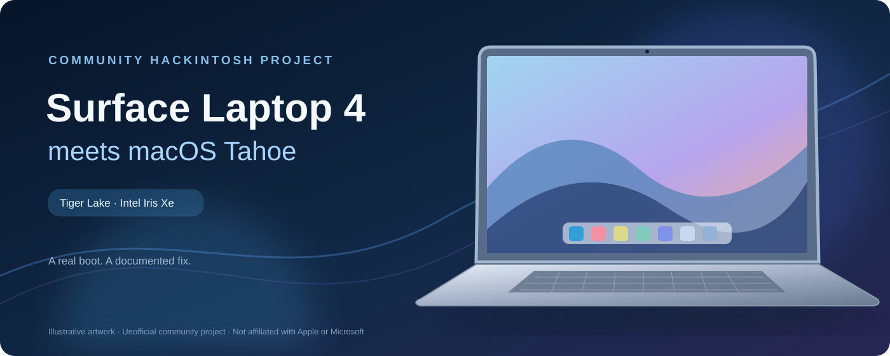

<p align="center"></p>

# Surface Laptop 4 — macOS Tahoe

Working **macOS Tahoe on an Intel Surface Laptop 4** alongside Windows 11. This repository contains the OpenCore configuration, the Surface-specific RTC fix, and a builder that downloads the pinned boot drivers.

  

## Quick Start

**Requirements:** Intel Surface Laptop 4 (tested: i7-1185G7), Python 3 on Windows, a 32 GB+ USB drive, and a backup of Windows.

**1. Clone the repository.**

```powershell
git clone https://github.com/Rulez777/Surface-Laptop-4-Tahoe-Hackintosh.git
```

**2. Generate private SMBIOS values.** Use [GenSMBIOS](https://github.com/corpnewt/GenSMBIOS) with model `MacBookPro16,2`. Generate a unique serial, MLB, SystemUUID and six-byte ROM. Never copy someone else’s serial numbers.

**3. Build the EFI and driver bundle.** Run inside the cloned project folder, replacing all placeholders:

```powershell
py -3 scripts/build_efi.py --serial YOUR_SERIAL --mlb YOUR_MLB --uuid YOUR_UUID --rom YOUR_12_HEX_DIGIT_ROM --out EFI-output
```

The script fetches official **OpenCore 1.0.8, Lilu 1.7.2, VirtualSMC 1.3.8, WhateverXe 0.8.3, AMFIAnchor 0.1.2, USBToolBox 1.2.0 and HfsPlus**, adds the Surface USB map and Intel A0ED injector, generates **SSDT-RTC0-SL4**, and checks the result with OpenCore `ocvalidate` on Windows. The output is `EFI-output/EFI/`. **The builder has not yet been independently boot-tested from a clean checkout; the confirmed boot used the original test-machine EFI.**

**4. Prepare the USB** as GPT with two volumes:

| Volume | Format | Files |
|---|---|---|
| `MACOS-OC` (~2 GB) | FAT32 | `EFI/` from the builder, and `com.apple.recovery.boot/BaseSystem.dmg` + `BaseSystem.chunklist` |
| `SL4DATA` (remaining space) | exFAT | Apple `InstallAssistant.pkg`, `BaseSystem.dmg`, `BaseSystem.chunklist`, and [UnPlugged.command](https://github.com/corpnewt/UnPlugged) |

Download Apple Recovery using OpenCore [macrecovery.py](https://github.com/acidanthera/OpenCorePkg/tree/master/Utilities/macrecovery). The tested Tahoe path used Board ID `Mac-CFF7D910A743CAAF`. Download the full Tahoe `InstallAssistant.pkg` **directly from Apple**; it is larger than FAT32’s file limit. Apple installer files are not distributed here.

**5. Boot and install.** Boot the Surface from USB, select **macOS Base System (External)** in OpenCore, then check the disks in Recovery with `diskutil list`. If `SL4DATA` is mounted, run:

```bash
bash /Volumes/SL4DATA/UnPlugged.command
```

Use **only a dedicated APFS macOS volume** as the installation target, choose **Copy**, review the final summary, and follow the installer. Keep booting through USB OpenCore during installation.

> **Windows dual-boot:** I used unallocated space for a separate Tahoe APFS container. Do not erase the internal SSD, Windows NTFS, Microsoft Reserved or Windows EFI partitions. See [safe partitioning](docs/SAFETY.md).

**Post-install: faster OpenCore.** The tested USB still had diagnostic logging. I provide a [quiet boot profile](docs/QUIET-BOOT.md) that removes verbose logs, shows the picker for 4 seconds, and supports saving **macOS Tahoe as default with Ctrl+Enter**. Windows remains selectable. The EFI builder now produces the quiet profile by default; use `--verbose-boot` to keep debug output for troubleshooting.

**6. Boot without the USB (after both OSes work).** Copy the *known-good Kingston* `EFI/OC` to the internal Windows EFI System Partition using the read-only/staging tool. Then add a **separate OpenCore firmware entry**, keeping Windows Boot Manager unchanged. Follow [Boot without USB](docs/INTERNAL-BOOT.md). Test Windows and Tahoe separately **before** making OpenCore the default. This internal boot method is documented but not yet verified on the test Surface.

**7. Optional hardware drivers.** Build a *separate* experimental EFI containing audio, Intel Wi-Fi/Bluetooth, BigSurface, VoodooI2C/VoodooPS2 and battery kexts. They are staged **disabled** by default, with opt-in test profiles for audio, Wi-Fi and Bluetooth:

```powershell
py -3 scripts/add_optional_drivers.py --source EFI-output/EFI --out EFI-peripherals
```

See [drivers and test profiles](docs/DRIVERS.md). **Do not overwrite the proven boot EFI with all experimental drivers at once.**

## Full hardware driver pack and performance

The initial Tahoe boot is **not a daily-driver performance result**: it used `-wex-noaccel`, which disables hardware graphics acceleration. That is a likely cause of the slow interface. The release-ready EFI and graphics-accelerated macOS are two different steps.

To fetch **all currently identified candidate drivers** and the verified WhateverXe Graphics 0.4.4 macOS package (without changing the booted EFI):

```powershell
py -3 scripts/prepare_full_driver_pack.py --source "C:\\path\\to\\personal\\EFI" --out SL4-Driver-Pack
```

This stages AppleALC, Tahoe AirportItlwm, Intel Bluetooth, BlueToolFixup, SMCBatteryManager, VoodooPS2, VoodooI2C/HID, BigSurface, NVMeFix and RestrictEvents, plus the IPTSDaemon ZIP. **Unverified drivers remain disabled.** The signed-graphics payload installer is downloaded to `SL4-Driver-Pack/macOS-Installers/`, and its official SHA-256 is checked. The existing EFI/boot order is never modified.

**Important:** [Iris Xe acceleration must be installed inside running macOS](docs/GRAPHICS-ACCELERATION.md) and `-wex-noaccel` must only be removed after the WEX/AMFI/SIP dependencies have been verified. A complete verified, working driver set for Surface Laptop 4 on Tahoe has not yet been established. This project does not advertise full support for BigSurface input or hardware Metal before tests.

## Test machine

| Component | Configuration |
|---|---|
| Model | Surface Laptop 4 — Intel |
| CPU | Core i7-1185G7 (Tiger Lake-UP3) |
| GPU | Iris Xe 96 EU, `8086:9A49` |
| Memory | 16 GB |
| Storage | Samsung PM991 256 GB; Windows 11 on separate partition |
| Bootloader | OpenCore 1.0.8 |
| macOS | Tahoe 26.x; tested full installer package 26.7.1 |
| Initial graphics | WhateverXe 0.8.3 with `-wex-noaccel` |

## Compatibility

| Feature | Status |
|---|---|
| Tahoe Recovery and installed OS boot | **Confirmed on test machine** |
| Windows + separate macOS partition | **Created without erasing Windows** |
| Iris Xe display output | **Basic GUI output** |
| Metal acceleration | Not verified |
| Built-in keyboard, trackpad, touch | Not verified |
| Wi-Fi, Bluetooth, audio | Not verified |
| Sleep, battery, cameras, sustained NVMe stability | Not verified |

This is an **initial-boot EFI**, not a claim of complete device support. See [driver versions and follow-up testing](docs/DRIVERS.md).

## The RTC0 fix

The test machine exposes `ACPI000E` at `\_SB.SRTC`, but no conventional `PNP0B00` RTC in its exported ACPI tables. Its LPC path is `\_SB.PC00.LPCB`, while the upstream OpenCore RTC sample targets `PCI0.LPCB`.

I adapted the compiled RTC0 sample from `PCI0` to `PC00`, recalculated the ACPI checksum, and enabled `SSDT-RTC0-SL4.aml` in OpenCore. **Tahoe Recovery reached the GUI after this change**, where earlier builds had stopped during early kernel initialization. The builder reproduces the change automatically.

[Read the full technical notes](docs/RTC0-CASE-STUDY.md).

## Repository contents

- [`scripts/build_efi.py`](scripts/build_efi.py): builds a personal boot EFI with pinned upstream binaries.
- [`scripts/quiet_boot.py`](scripts/quiet_boot.py): switches an existing working EFI to a quiet 4-second boot picker with a private backup.
- [`docs/QUIET-BOOT.md`](docs/QUIET-BOOT.md): set Tahoe as default, keep Windows in the menu, and roll back.
- [`scripts/add_optional_drivers.py`](scripts/add_optional_drivers.py): builds a separate optional kext pack for peripheral experiments.
- [`scripts/prepare_full_driver_pack.py`](scripts/prepare_full_driver_pack.py): fetches all pinned candidate kexts, IPTSDaemon and the verified WhateverXe Graphics package.
- [`docs/GRAPHICS-ACCELERATION.md`](docs/GRAPHICS-ACCELERATION.md): requirements for Metal acceleration on Iris Xe and safe rollback.
- [`scripts/stage_internal_efi.ps1`](scripts/stage_internal_efi.ps1): stages the tested USB EFI on the internal Windows ESP without altering Windows Boot Manager.
- [`docs/INTERNAL-BOOT.md`](docs/INTERNAL-BOOT.md): adds an independent firmware entry for USB-free Windows/Tahoe selection.
- [`data/seed.lzma.b64`](data/seed.lzma.b64): sanitized configuration and device-specific USB/ACPI descriptors.
- [`docs/DRIVERS.md`](docs/DRIVERS.md): versions, features and post-install limits.
- [`docs/SAFETY.md`](docs/SAFETY.md): preserving Windows and its bootloader.
- [`docs/RTC0-CASE-STUDY.md`](docs/RTC0-CASE-STUDY.md): RTC0 investigation and the successful change.

## Credits

[OpenCore](https://github.com/acidanthera/OpenCorePkg) · [Lilu](https://github.com/acidanthera/Lilu) · [VirtualSMC](https://github.com/acidanthera/VirtualSMC) · [WhateverXe](https://github.com/b00t0x/WhateverXe) · [AMFIAnchor](https://github.com/b00t0x/AMFIAnchor) · [USBToolBox](https://github.com/USBToolBox/kext) · [Dortania](https://dortania.github.io/) · [UnPlugged](https://github.com/corpnewt/UnPlugged)

Independent community project. Not affiliated with Apple or Microsoft. The banner is illustrative artwork, not a test screenshot. Back up your data and review applicable software licenses.
